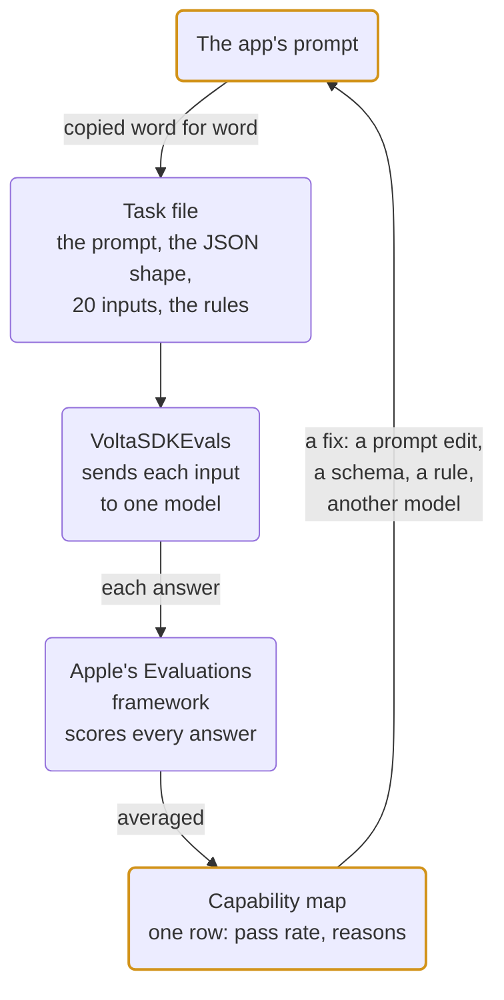
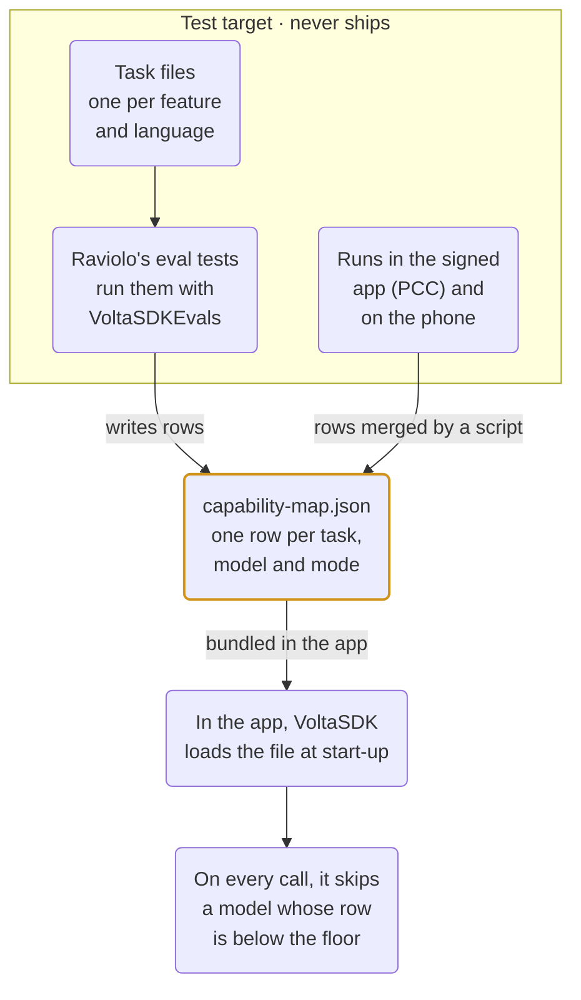
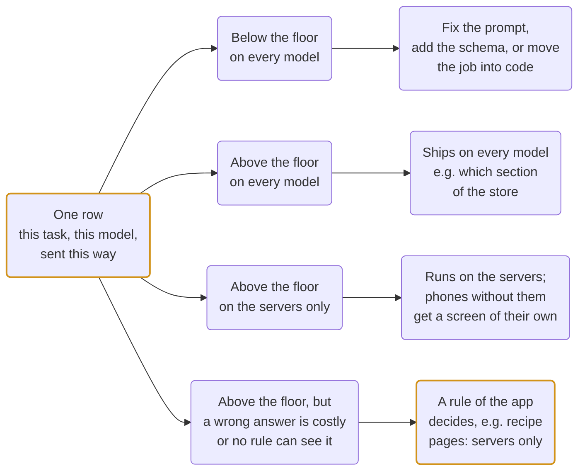

*The fourth piece in the series. Parts 1 to 3 built the fallback chain,
the ordered list of models VoltaSDK tries for each call until one answers.
This one measures what each of those models can actually do, with Apple's
Evaluations framework and my own app, Raviolo, as the case study. Most of the work
ran on the iOS/macOS 27 beta (Xcode 27, build 27A5237l) and finished on
the final Xcode 27.0 (27A266a). Where a number comes from the beta, the
text says so.*

The rule of the series stays the same. Take one WWDC session, build what it
teaches, write down what I learn. This one follows three:
[**Meet the Evaluations framework**](https://developer.apple.com/videos/play/wwdc2026/298/)
(session 298),
[**Create robust evaluations for agentic apps**](https://developer.apple.com/videos/play/wwdc2026/299/)
(session 299), and
[**Improve your prompts by hill-climbing**](https://developer.apple.com/videos/play/wwdc2026/335/)
(session 335).

## The question

A model does not give the same answer twice, so it cannot be tested the way
a function is tested. What can be done is to ask it the same kind of thing
twenty times and count how many answers are good enough for the feature.
That count is an evaluation, and it answers the question in the title.
Thirteen good answers out of twenty is enough for one feature on one model
and useless for another, and **until the count exists the decision is
made by feel**.

### Where I started

I had been making it by feel. Raviolo, my meal app, shipped with on-device
Apple Intelligence only, and on my iPhone its assistant produced many kinds
of failure, for example:

- it claimed to have added an item to the shopping list without adding it;
- it returned a meal record with every field empty;
- it answered a clear meal with a sentence and no JSON at all.

Each fix was a prompt edit followed by a few taps on the phone, and **I had
no way of knowing whether the edit had helped or merely moved the
failure**.

## What Apple announced

A framework for testing software whose output is not the same twice,
sitting beside XCTest and Swift Testing.

### The four parts of an evaluation

| Part | What it is |
|---|---|
| Dataset | the questions |
| Subject | the code that produces an answer for each question |
| Evaluators | the rules that score an answer |
| Metrics | what gets averaged at the end |

Each result passes, fails, gets a score, or is ignored, always with a
reason attached. The results are tables that can be saved as JSON.

### What the other two sessions add

- **Session 299** adds tests for multi-step tool use, and lets a model
  generate the test inputs.
- **Session 335** uses a model to judge another model's answers, and says
  to measure how often the judge agrees with a person before trusting it.

### Why it fits VoltaSDK

The code under test is ordinary Swift, and the framework does not care
what is behind it. **So anything can be measured, including VoltaSDK's fallback
chain exactly as the app uses it.**

## The case study

[Raviolo](https://deruloop.dev/raviolo) is my meal app. The person tells
it what they are eating, what they need to buy, and what they would like to
cook, and an assistant answers. It is
[on the App Store](https://apps.apple.com/it/app/raviolo/id6816085710) for
iPhone and Mac, free while in beta and without an account, and an Android
version is in the works. It is a SwiftUI app with a shared core in Kotlin
Multiplatform.

Every number in this piece was measured on Raviolo's real prompts, the
ones the app sends.

### The assistant on the first day

When the measuring started, the assistant was one system prompt of about
two thousand characters, running on the phone's model only, with four
jobs.

1. **Read a meal.** "Crackers and cheese" had to come back as a small JSON
   record: the foods, what each one brings (protein, fibre or good fats),
   whether the plate has enough of each, one to three additions that would
   balance it, and a short warm note.
2. **Keep that record across turns**, so "and an apple" a minute later
   added the apple without losing the crackers.
3. **Notice a shopping request.** "I'm out of bread" had to come back in a
   different shape, a list of items to add.
4. **Read a recipe out of a web page**, with a separate prompt.

### What it grew into

Over the following weeks the assistant grew into five characters. They
have their own article; here their names come up now and then:

- **Misto Manzo**, the cook;
- **Spinacio**, the shopping assistant, with a list that knows the
  person's own store;
- **Olio**, who looks after the plate and suggests the one addition that
  would complete it;
- **Ricotta**, who keeps a notebook of allergies, intolerances and
  dislikes, and makes every recipe respect them;
- **Amaretto**, who answers questions of fact and technique, like which
  foods have fibre or how to save a split sauce.

Olio is called in with a button. Ricotta and Amaretto step in by
themselves when a message is theirs.

[Video: the cook's chat with Olio on stage](/blog/raviolo-olio-on-stage.mp4)

*The meal record that failed in the first week, as it works now, on
Private Cloud Compute. The cook answers "crackers and cheese" with a
recipe. Olio reads the plate and suggests roasted chickpeas; with the
chickpeas on it he suggests sliced cucumber, and "Refine into a full
recipe" hands the plate back to Misto Manzo, who writes it out.*

For this piece they matter for one reason only. Every one of their
behaviours is a prompt, **every prompt got a dataset before it shipped,
and every dataset was run again whenever the prompt changed**.

## How a feature gets measured

The same six steps ran for every feature in the app, from the meal record
on the first day to the recipe pages on the last. Here they are once, on
the meal record, with the code each step actually runs.



*The loop. Every section after this one is about one of these arrows: a change to the app on the left, read as a new row on the right.*

### 1. The prompt becomes a task

In Raviolo, every request to a model passes through one Swift function,
`generateStructured`. It is the only place where the app talks to
VoltaSDK, and it receives four things:

- the instructions, which are the prompt itself (the text lives as a
  constant in the app's shared Kotlin code, with every other prompt);
- the JSON shape the app expects back;
- the conversation so far;
- the name of the task this request belongs to, with the language in it
  (`"raviolo.task-a.en"`).

This is the app itself at work. Nothing here is about evaluation yet.

```swift
// VoltaTextGenerator.swift, the app's boundary with VoltaSDK
func generateStructured(instructions: String, prompt: String, history: [ChatMessage],
                        schemaJson: String, tier: AiTier, taskId: String?) async throws -> String {
    let schema = try JSONDecoder().decode(OutputSchema.self, from: Data(schemaJson.utf8))
    let turns: [ChatTurn] = history.map { $0.isFromUser ? .user($0.text) : .assistant($0.text) }
    let response = try await orchestrator.respondStructured(
        to: prompt,
        instructions: instructions,              // the app's prompt, one constant
        history: turns,
        schema: schema,                          // the shape the parser accepts
        need: need,
        task: taskId.map { TaskRequirement($0, minimumPassRate: Self.minimumPassRate) }   // "raviolo.task-a.en"
    )
    return response.value.serialized()
}
```

A **task** is one job of the assistant written down as a file, so it can
be tested. **The task file for the meal record contains the same things
as this call.** It opens with
the same instructions, word for word, not tidied, not shortened, because
the point is to measure what actually ships. Then the same JSON shape, as
a schema. Then the inputs and the rules, which the next step is about.

```json
{
  "id": "raviolo.task-a.en",  "schemaVersion": "v18",  "language": "en",

  // 1. the instructions, verbatim (3488 characters)
  "instructions": "You are Olio, a tall, slender gentleman of impeccable manners who looks after balance in Misto Manzo's kitchen. Your name is Olio, and the person already sees it over every reply: never open with it, except on a fresh chat with no …",

  // 2. the shape the app expects back
  "schema": { "type": "object", "name": "MealRecord", "properties": [
    { "name": "title", "schema": { "type": "string" } },
    { "name": "items", "schema": { "type": "array", "items": { "type": "object", "name": "Item", "properties": [
        { "name": "name", "schema": { "type": "string" } },
        { "name": "compound", "schema": { "type": "string", "enum": ["protein", "fiber", "healthy_fats", "none"] } } ] } } },
    { "name": "compounds", … }, { "name": "completions", … }, { "name": "note", "schema": { "type": "string" } } ] },

  // 3. the inputs, each with what a correct answer must contain (20)
  "samples": [ {"id": "a-en-01", "turns": ["Crackers and cheese"], "expect": {"fields": {"compounds.protein": ["present", "light"], "compounds.healthy_fats": ["present", "light"]}}}, … ],

  // 4. the rules every answer must pass
  "graders": ["json-only", "schema", "required", "expect-fields", "language", "mentions"]
}
```

*Tasks/task-a.en.json, the task file for the meal record in English, trimmed to its four parts. The instructions are the app's own string; the comments are mine.*

### 2. The rules are written as data

A rule is one line in the task file: the name of a kind of check (fifteen
are built in) and its parameters. The SDK already knows how to apply each
kind. Two of the six on the meal record check that the note is in the
person's language and that it names at least one of the additions the
record suggests:

```json
{ "kind": "language", "params": { "path": "note" } },
{ "kind": "mentions",
  "params": { "path": "note", "of": "completions[].text", "name": "note-names-additions" } }
```

Each kind is a small function in the SDK. A sample passes only if every rule passes, and the reasons for any
failure are joined into the message the test prints. When the model could
not be asked at all (it was switched off, it was busy, or the input was too
long for it), the rules skip that input and the engine counts it apart as
"model unavailable". **The pass rate only ever measures answers the model
actually gave.**

The inputs sit in the same file, twenty of them, typed the way people type
on a phone. Every phrasing that later failed on my own phone was added to
them. Next to each one is what a correct answer must contain:

```json
// one input and its expectation
{
  "id": "a-en-01",
  "turns": [
    "Crackers and cheese"
  ],
  "expect": {
    "fields": {
      "compounds.protein": [
        "present",
        "light"
      ],
      "compounds.healthy_fats": [
        "present",
        "light"
      ]
    }
  }
}

// the rules, applied to every answer
[
  {
    "kind": "json-only"
  },
  {
    "kind": "schema"
  },
  {
    "kind": "required",
    "params": {
      "paths": [
        "title",
        "items:1",
        "completions:1:3",
        "note"
      ]
    }
  },
  {
    "kind": "expect-fields"
  },
  {
    "kind": "language",
    "params": {
      "path": "note"
    }
  },
  {
    "kind": "mentions",
    "params": {
      "path": "note",
      "of": "completions[].text",
      "name": "note-names-additions"
    }
  }
]
```

*One sample and the six rules. "Crackers and cheese" must come back with protein and good fats present or light; the note must be in English and must name one of the additions the record itself proposes.*

### 3. The task runs as a test

This is the whole test for the meal record in Raviolo's test target. It
loads the task for one language, runs it against one model in two modes,
saves the results, and checks the pass rate against a
minimum. These tests run only from a separate Xcode scheme that sets
`RAVIOLO_EVALS=1`, so running the app's normal tests never calls a model.

```swift
// RavioloEvals.swift (the app's test target)
@Suite("Raviolo evals — on-device", .serialized)
struct OnDeviceEvals {
    @Test("Task A — the meal record is well-formed and sensible", arguments: ["it", "en"])
    func mealRecord(language: String) async throws {
        guard RavioloTasks.isEnabled else { return }                 // RAVIOLO_EVALS=1
        guard #available(iOS 27, macOS 27, *) else { return }        // the framework is OS 27+
        let task = try RavioloTasks.task("task-a.\(language)")       // Tasks/task-a.en.json
        _ = try await RavioloTasks.measure(task, provider: OnDeviceProvider(), mode: .raw)
        let structured = try await RavioloTasks.measure(task, provider: OnDeviceProvider(), mode: .structured(repair: .none))
        #expect(structured >= 0.5, "\(language): measured floor from Sep 2026")
    }
}
```

The two `measure` calls differ only in the **mode**, which is how the
prompt is sent. *Raw* sends it as plain text and takes whatever comes
back. *Structured* sends it with the schema, so the model has to answer in
the JSON shape the app expects.

`measure` is a small helper in the same target. It runs the task, saves
the result in the map described in the next step, and returns the pass
rate. VoltaSDK's
guide has its code.

Inside `TaskEvaluation`, Apple's framework does the looping. For each
input:

1. VoltaSDK sends the prompt to the chosen model, through the same
   `respond` or `respondStructured` the app itself calls;
2. the rules above score the answer;
3. at the end, the framework averages the scores and saves every prompt,
   answer and verdict to a file.

A failing test prints the pass rate and the reasons, one per failed
sample:

```text
Test Case 'RavioloEvals.mealRecord(language: "en", tier: on-device, mode: raw)' failed

  ✘ Expectation failed: (result.passRate → 0.0) >= 0.6
    pass rate 0/18 · model available 18/20 · schema 0%

    reasons, one per failed sample:
    · json-only: unparseable JSON: invalidJSON("The data couldn’t be read because it isn’t in the correct format.") | schema: no parsed JSON | expect-shape: no parsed JSON | required: no parsed JSON | expect-fields: no parsed JSON | lan
    · schema: $: matches none of the 2 allowed shapes; closest: $.items[0].compound: "protein|fiber|healthy_fats" is not one of ["protein", "fiber", "healthy_fats"]; $.compounds.protein: "present|light|missing" is not one of ["present",
    · schema: $: matches none of the 2 allowed shapes; closest: $.items[0].compound: "protein|fiber|healthy_fats" is not one of ["protein", "fiber", "healthy_fats"]; $.compounds.protein: "present|light|missing" is not one of ["present",
    · … 15 more
```

*What a failing test prints (Cmd-U on the RavioloEvals scheme). The reasons are the finding: one answer was not JSON at all, and the rest returned the list of allowed values, "protein|fiber|healthy_fats", as the value instead of picking one.*

### 4. The row goes into the map

The **map** is one JSON file in the app's repository,
`RavioloEvals/Results/capability-map.json`, and it is a plain list of
**rows**, one per result.
**Each row is named by three things: the task, the model, and how the
prompt was sent** (as written, or through the schema). The meal record in
English on the phone's model through the schema is one row; the same task
on Private Cloud Compute is another.

The helper writes a row with `upsert`, which looks for a row with the same
three names. If there is one, the new run replaces it; if there is none,
the run is added. So the file always holds the latest
measurement of every combination that was ever run, and nothing else. This
is one real row, trimmed:

```json
{
  "task": "raviolo.task-a.en",
  "provider": "on-device",
  "mode": "structured",
  "schemaVersion": "v18",
  "passed": 17, "scored": 20, "passRate": 0.85,
  "availabilityRate": 1,
  "graders": { "schema": 1, "json-only": 1, "required": 1, "expect-fields": 0.91,
               "language:note": 1, "note-names-additions": 0.9 },
  "failureSamples": [ "note-names-additions: note names none of completions[].text ([\"hard-boiled egg\"])",
                      "expect-fields: compounds.protein=missing not in [\"present\", \"light\"]" ],
  "meanLatencySeconds": 7.0,
  "host": "Mac M2, macOS 27.0",
  "runAt": "2026-10-25T08:39:50Z"
}
```

Besides the pass rate, a row keeps how often each rule passed, a few of the
failure reasons, the latency, the prompt version it measured, and how often
the model could be reached at all.

The Mac writes the file directly. Private Cloud Compute and the phone
cannot reach the repository, so their tests print each row in the log and
a script in VoltaSDK, `evals-merge.py`, merges those lines into the file.

| Model | How the prompt was sent | Passed | Prompt version | Measured |
|---|---|---|---|---|
| the phone's model | as written (raw) | 0 of 18 | v2 | 17 Sep |
| the phone's model | with the schema (structured) | 17 of 20 | v18 | 25 Oct |
| Private Cloud Compute | as written (raw) | 16 of 20 | v2 | 17 Sep |
| Private Cloud Compute | with the schema (structured) | 18 of 20 | v18 | 25 Oct |

*The meal record in English, as the map holds it today. Each line is one row: this task, on one model, sent one way. "Passed" counts the answers that met every rule; two raw answers on the phone are missing because the model could not be reached for them. The map keeps only the latest run of each line, so the two raw lines are old: once the app moved to the schema, the raw prompt was never measured again, and its rows still carry the prompt version of that time.*

### 5. The app changes, and the task runs again

This is the step that makes the rest worth doing. A failure with a reason
points at one of four fixes:

- a prompt edit;
- a schema on the call;
- a rule in the app;
- a different **tier** for that job, meaning a different model: Apple
  Intelligence on the phone, Private Cloud Compute, or a cloud model such
  as OpenAI's.

Whichever it is, the same test runs again and the new row sits next to the
old one. **Every before-and-after number in this piece is two such rows,
read side by side.** Running a twenty-input task takes about a minute on
the phone's model and a few minutes on Private Cloud Compute, which is
cheap enough to do after every change to a prompt.

| Meal record, Italian dataset, on-device | Pass | Schema | First reason |
|---|---|---|---|
| raw prompt, 14 Sep | 0/20 | 0% | json-only: unparseable JSON: invalidJSON("The data couldn’t be read because it isn’t in the correct format.") \| schema: no parsed JSON \| exp… |
| through the schema, 14 Sep | **12/20** | **100%** | language:note: detected en, expected it |
| language named in the prompt, 16 Sep | **17/20** | 100% | expect-fields: compounds.healthy_fats=missing not in [present, light] |

*Three rows of the same task, read in order. This is the Italian dataset, because the second row's failure is about language. The schema removed the shape failure and uncovered the language failure; naming the language removed that one and left the honest disagreements about whether crackers bring enough fat.*

### 6. The map ships inside the app

The last arrow goes back into the app, and it crosses from one library to
the other. The package has two:

- **`VoltaSDKEvals`** runs the tasks and writes the map. Only the test
  target uses it, so it never ships in the app.
- **`VoltaSDK`** is the library the app already uses for every model call.
  It reads the map.

The file is the only thing the two share. The same `capability-map.json`
the tests write is added to the app target as a resource.



*One file between two libraries. VoltaSDKEvals writes the map from the test target, and rows from the runs that cannot reach the repository are merged in by a script. The app ships the same file, and VoltaSDK reads it on every call.*

At start-up the app loads the file with `MeasuredCapabilities` and hands
it to VoltaSDK in `AIConfiguration.capabilities`. Each call already names
its task (the `task:` argument in step 1), with a minimum pass rate of
0.6. For every model in the chain, VoltaSDK looks up the row for that
task, that model, and the way the call sends the prompt:

- a model with no row for this task, or with too few samples, is tried;
- a model whose row is below the minimum is skipped, and the skip is
  logged.

```swift
// VoltaSDK/MeasuredCapabilities.swift
func admits(_ provider: any ModelProvider, mode: MeasuredCapabilities.Mode, in capabilities: MeasuredCapabilities?) -> Bool {
    guard let capabilities,
          let row = capabilities.measurement(task: id, provider: provider.identifier, mode: mode),
          row.samples >= minimumSamples else { return true }     // unmeasured: tried
    return row.passRate >= minimumPassRate                        // measured below the floor: skipped
}

// VoltaSDK/AIOrchestrator.swift, the chain for one call
func orderedProviders(for need: ModelNeed?, task: TaskRequirement?, mode: Mode) -> [any ModelProvider] {
    let ordered = orderedProviders(for: need)
    guard let task, let capabilities else { return ordered }
    return ordered.filter { provider in
        let admitted = task.admits(provider, mode: mode, in: capabilities)
        if !admitted { Self.logSkip(task: task, provider: provider, mode: mode, capabilities: capabilities) }
        return admitted
    }
}
```

`canServe(task)` asks the same question before any call, so a screen can
know whether any model can do the job, instead of finding out from a
failed request.

### One dataset per language

The app answers in whatever language the person writes, Italian and
English for now, so every task exists twice, once per language, with its
own inputs and its own row in the map. That doubling looked like extra
work on the first day and turned out to be the most useful decision of the
week. The small model often answered Italian input in English. One mixed
dataset would have hidden that; **comparing the Italian row with the
English one showed it**.

### How big the datasets are

Every feature got a task of the same shape: twenty inputs when a feature
has that many real phrasings, fewer when it does not (there are only so
many recipe pages and store descriptions to type). The count sits in
parentheses next to every number in this piece. By the end the map held
206 measured rows over 95 tasks, and what follows is what that loop taught
me about the models, the framework, and my own prompts.

### What the setup takes

VoltaSDK is open source at
[github.com/deruloop/VoltaSDK](https://github.com/deruloop/VoltaSDK), and
the repository is the place to start. Everything above needs a separate
test target with its own scheme, the task files bundled into it, one test
per feature, the map file in the app, and a signed app for the PCC runs.
VoltaSDK's evaluation guide,
[docs/evals/README.md](https://github.com/deruloop/VoltaSDK/blob/main/docs/evals/README.md),
walks through each part with code, and
[TASK-FORMAT.md](https://github.com/deruloop/VoltaSDK/blob/main/docs/evals/TASK-FORMAT.md)
lists every field of a task file and every built-in check.

## What changed in VoltaSDK

### An evaluation library for the test target

Apple's framework expects the developer to write all four parts of an
evaluation in Swift, for one specific model. `VoltaSDKEvals` fills them in
from a task file: the inputs and the rules come from the file, and the
model under test is any VoltaSDK provider chosen in code. The rules come
from fifteen built-in checks, so an app never writes scoring code. Five of
the fifteen were added because Raviolo needed them. One lets a rule apply
only to the inputs where it makes sense: a recipe page with no amounts
cannot give amounts, and PCC was being marked wrong for leaving them out.

### Structured output

The raw prompt scored 0 of 20 on the meal record because the phone's model
copied the list of allowed values into the answer instead of picking one.
Only the SDK knows which model answered, so the SDK is the place to make
sure the answer is valid. `respondStructured` takes a schema. Where the
model has its own way to force the shape (Apple's models and the cloud
vendors all do), it uses that. Then it checks the answer, gives the same
model one chance to fix it, and if that fails too it returns an error the
fallback chain can act on.

### The release

PCC can only be measured from inside a signed app, so the macOS and iOS
demo apps each carry a test bundle built on the same library. A model
judge can use any cloud model to score answers, and it reports how often
it agrees with a person's ratings before its scores are trusted.
Everything shipped as **VoltaSDK 1.2.0** on 22 October, with nothing from
1.1 changed. It is also the first 1.x release that builds for an iPhone:
the first run of the evaluations on a real phone found that the PCC check
used an API that exists only on macOS.

## What the map showed

Every number is passes out of inputs, with the app's own prompts.
"On-device" is the Mac's Apple Intelligence model standing in for the
phone's, the same model family.

| Task (inputs) | On-device, raw | On-device, structured | PCC, raw | PCC, structured |
|---|---|---|---|---|
| A · meal record (20) | 0/20 | 12/20 | 14/20 | 18/20 |
| A′ · retention (8) | 0/8 | 0/8 † | 5/8 | 7/8 |
| B · shopping intent (20) | 0/20 | 0/20 | 16/20 | 16/20 |
| C · recipe page (7) | 6/7 | 7/7 | 6/7 | 6/7 |

*The first day's map, Italian inputs, 14 September. † Every item was kept on the second turn; the row reads 0/8 because the note came back in English.*

### The first day

The phone's model, Italian inputs, the prompt sent as written against the
same prompt sent through the schema:

| Feature | raw | structured |
|---|---|---|
| Meal record (20) | 0/20 | 12/20 |
| Retention over two turns (8) | 0/8 | 0/8, every item kept, the note in English |
| Shopping intent inside the big prompt (20) | 0/20 | 0/20 |
| Recipe extraction, 7 Wikibooks pages | 6/7 | 7/7 |

- **The schema fixed the shape everywhere**, 0% to 100% valid JSON on
  every task.
- **The phone's model does keep the list across turns.** It could not
  write it in the shape the raw prompt asked for. The row stayed at 0 of 8
  only because the note came back in English, and naming the person's
  language in the prompt took it to 8 of 8.
- **The shopping row stayed at zero in every mode.** Inside the full
  assistant prompt, the model never picked the shopping shape. Asked one
  question only, "is this a shopping request?", it scored 25 of 28. **A
  schema fixes the shape of an answer and nothing about the reading.**

On Private Cloud Compute the same day, the record scored 14 of 20 raw and
18 of 20 structured, and the indirect shopping phrasings ("we could use
some pasta") 16 of 20 in every mode.

### After a week of prompt work

The same datasets, run against each new version of the prompts. The last
four rows are features that arrived during the week, each measured from
the day it was written.

| Feature | on-device, first | on-device, final | PCC, final |
|---|---|---|---|
| Meal record (Italian, 20) | 0/20 raw, 12/20 structured | 16/20 | 19/20 |
| Retention across turns (8) | unmeasurable raw | 8/8 | 8/8 |
| Implicit shopping intent in the big prompt (20) | 0/20 | dropped, rules instead | 16/20 |
| Recipe extraction, 7 Wikibooks pages (Italian) | 6/7 raw | 7/7 | 7/7 |
| Recipe extraction, 61 real pages in five languages | (not measured) | 50/61 | 61/61 |
| A recipe for a dish asked for by name (10) | 6/10 | 6/10 | 10/10 |
| A recipe under a gluten note, exception held (8) | 0/8 | 0/8, rule in the app | 8/8 |
| A cooking question answered (English, 20) | 13/20 | 17/20 | 19/20 |
| A fact about food answered correctly (12, then 27) | 6/12 | 20/24 | 26/27 |

Two rows never moved on the phone whatever the wording: a dish asked for
by name, and a rule with an exception in the same prompt ("no gluten"
with "gluten-free pasta is fine"). Both need knowledge rather than shape,
so the map sends both to PCC first.
Across the whole map, **the small model follows one rule well and breaks
when two rules pull against each other or when the answer needs
knowledge.**

## What a small model does with a prompt

The larger models read a prompt as written. The phone's model copies
whatever is concrete in it and breaks when asked to choose. Each line in
the table below cost a measurement run.

With example values in the instructions:

```text
"ingredients":[{"quantity":"200 g","name":"..."}],
"servings":4, "totalTimeMinutes":30
```

The phone's answer for the homepage of ANSA, an Italian news site:

```json
{"found": true, "title": "",
 "servings": 4, "totalTimeMinutes": 30,
 "ingredients": [{"quantity": "200 g", "name": ""}],
 "steps": [""]}
```

With the shape only:

```text
"ingredients":[{"quantity":"...","name":"..."}],
"servings":..., "totalTimeMinutes":...
"found" is true only when the page holds one
recipe with its ingredients and its method.
```

The same page, the same model:

```json
{"found": false, "title": "",
 "ingredients": [], "steps": []}
```

*An example is a spec literal. Given a news site's homepage, the phone's model returned the prompt's example values as a recipe: four servings, thirty minutes, 200 g of nothing. With the values replaced by placeholders and a found field to say no, the same page gets no recipe. The meal record's note had failed the same way on 17 September.*

| What the prompt said | What the phone's model did | The fix |
|---|---|---|
| “do not mention Ricotta” | “Ricotta, you’re making me flustered” | describe the reply without the name, or handle the rule in code |
| an example of the note | returned the example word for word, whatever the meal (2 of 20) | describe the field, no example (16 of 20) |
| an example ingredient, “200 g” | a recipe for a news homepage, every ingredient 200 g | placeholders instead of values, and a field that says “no recipe here” |
| three cases in one prompt: tease a habit, note the season, else one line | teased on every add (23 of 23 down to 16 of 23) | the app picks the case; one short prompt each |
| “also point out which items are in season” | dropped the other items from the list (3 of 10) | a table of seasons in code; the model only writes |
| “talks about food the way a friend at the gym talks about a good set” | talked about the gym in every reply | describe the voice to the model, never as a comparison it can quote |

*Six things the phone's model did with a prompt, and what fixed each. The pattern in the middle column is the same every time: whatever is concrete in the prompt (a name, an example, a comparison) comes back in the answer, and any choice left to the model goes wrong.*

## From a row to a decision

A row answers one question: how often does this model get this job
right? Four things can follow from it, and every decision in the app was
one of the four.



*The four things a row can lead to. The first is step 5 of the loop, the task run again after a fix. The second and third are what the map decides on its own at runtime. The fourth is the one it cannot: when a wrong answer costs more than a missed one, or when a sentence passes every rule and still reads badly, the app keeps a rule of its own next to the map.*

One example, the recipe page. The phone's model read real recipe pages
right 50 times in 61, above the floor of 0.6, so by the map it stays in
the chain. But on pages with no recipe it invented one a third of the
time, where PCC answered "no recipe found" every time. **An invented
recipe is worse than none, and the map cannot know that: it only counts
passes.** So reading pages is a job for the servers only, by a rule of
the app's own. With the servers off, the app says so instead of asking
the phone. The shopping list was built the same way, from four datasets
measured before any code existed; each question went where its row sent
it.

The same engine also settled two questions Part 3 had left open. Quality
holds when the chain switches model in the middle of a conversation, 24
of 24 items kept from the phone to the servers, because the app sends the
history with every call. And the phone's model reads long pages fine once
the output is structured, 7 of 7 up to 12,000 characters; its reputation
for weakness with long inputs was a shape failure in disguise.

## What to watch for

- **Private Cloud Compute refuses every call after a few hundred in 24
  hours.** The engine counts those as "model unavailable", not as wrong
  answers, and such a row is never saved over a good one.
- **Task files fall out of date.** Check them against the app's prompts
  before every run; one morning of measurements ran against a prompt the
  app no longer sent.
- **A rule can be wrong and reward the wrong model.** PCC was marked
  wrong for leaving absent amounts empty while the phone passed by
  inventing them.
- **Every on-device number here is the Mac's model standing in for the
  phone's.** The cloud tier and the judge still wait for keys.
- **Twenty inputs** show 0% becoming 60%. They cannot rank two prompts
  that differ by three answers.

## The sessions this implements

▶ [**Meet the Evaluations framework**](https://developer.apple.com/videos/play/wwdc2026/298/),
session 298, for the framework's shape;
[**Create robust evaluations for agentic apps**](https://developer.apple.com/videos/play/wwdc2026/299/),
session 299, for trajectories and synthetic samples;
[**Improve your prompts by hill-climbing**](https://developer.apple.com/videos/play/wwdc2026/335/),
session 335, for the judge and how to distrust it correctly.

## Next

- **The judge** and **the cloud rows**, both waiting on keys.
- **The full real-iPhone row.**
- **Raviolo's own piece**: what the five characters are and what the
  person sees, told without the tables. Until then the app itself is the
  best place to meet them, on
  [the App Store](https://apps.apple.com/it/app/raviolo/id6816085710).
